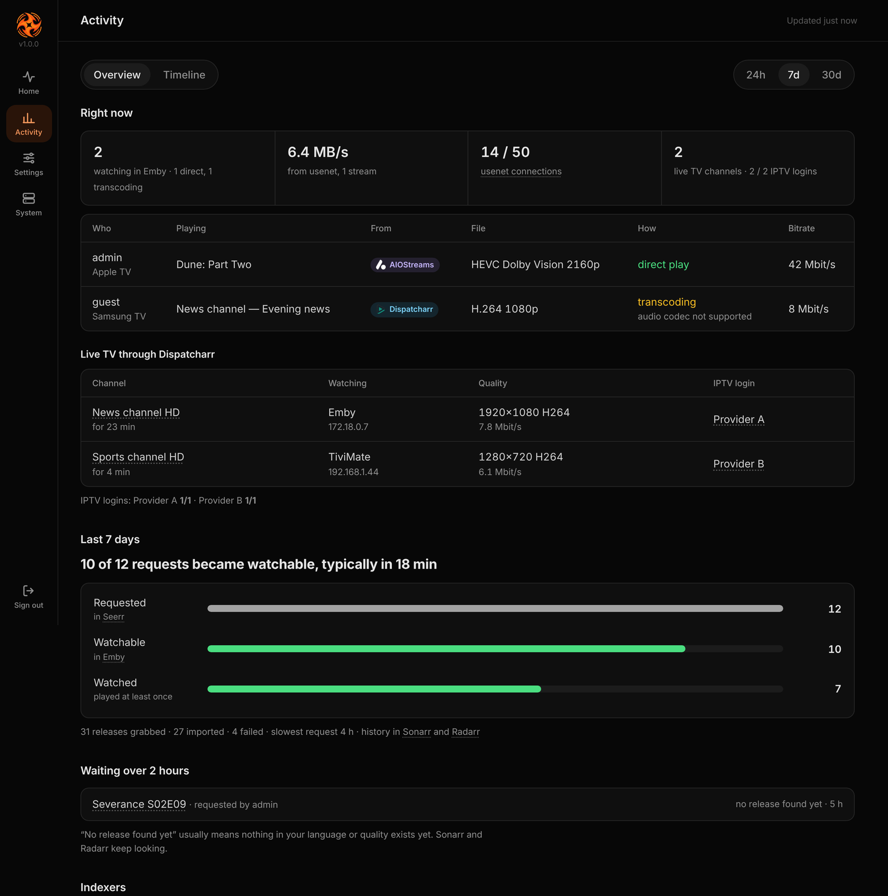

<div align="center">


**A streaming-first Usenet media stack that builds and wires itself.**
Nothing is downloaded. Your library takes almost no disk.

[](LICENSE)
[](bootstrap.sh)
[](compose/stack.yml)

</div>

---

## What this is

One script turns a fresh Debian VM into a complete media stack — request, search, stream, subtitles, play, and optionally live TV — with every app already wired to the others. You answer a few questions in your browser (every login and key is tested on the spot) and it builds. The answers live in `ninjarr.env`, so the same stack rebuilds from that file without asking again. **Dojo**, its control panel, is where you check on it and change things.

The trick: **AIOStreams' usenet engine is the download client.** Sonarr and Radarr grab NZBs as usual, but nothing is downloaded. AIOStreams checks the release against your provider and exposes it as a file, the arr imports a *symlink*, and Emby plays it while AIOStreams streams the bytes from usenet on demand.

<p align="center"></p>

## How a request flows

```
 Seerr ──request──▶ Sonarr / Radarr ──search──▶ Prowlarr ──▶ your indexers
 (you ask)                │  ▲
                          │  └── the arr fetches the NZB itself (Prowlarr "redirect")
                          ▼
                     AIOStreams ──checks articles──▶ your usenet provider(s)
                          │
                 symlink in /library ──▶ Emby plays it, bytes stream on demand
                          │
                       Bazarr adds subtitles
```

**Indexer rules:** some indexers forbid streaming tools from searching or grabbing. In ninjarr only Sonarr and Radarr talk to your indexers: Prowlarr redirects grabs so the arr fetches the NZB itself, and AIOStreams only ever receives the finished NZB (its own indexer feed is off). Still, read your indexer's rules — whether streaming the result is allowed is between you and them.

## What you need

- **A usenet provider** (Easynews, Eweka, Newshosting, …) — the servers that hold the files.
- **At least one NZB indexer** — a search engine over usenet. Optional during setup; add it later in Dojo or Prowlarr.
- **A VM**: Debian 12/13 or Ubuntu 22.04+, 2+ cores, 4+ GB RAM, 40 GB disk. A VM rather than an LXC container, because AIOStreams mounts its library with FUSE. (LXC with `features: nesting=1,fuse=1` works, but isn't the tested path.)
- **Optional:** a domain, to reach Emby, Seerr and AIOStreams away from home ([below](#away-from-home-optional)); an IPTV subscription for [Live TV](#live-tv-optional).

## Run it

**On Proxmox**, let ninjarr create the VM — on the Proxmox host:

```bash
curl -fsSLO https://raw.githubusercontent.com/DBCooperX/ninjarr/main/proxmox/create-vm.sh
chmod +x create-vm.sh
./create-vm.sh                         # then: ssh ninjarr@<vm>, sudo -i, cd /opt/ninjarr-src, ./bootstrap.sh
./create-vm.sh --env ninjarr.env       # or: the VM builds the whole stack by itself from your ninjarr.env
```

**On any Debian/Ubuntu VM:**

```bash
sudo -i
git clone https://github.com/DBCooperX/ninjarr.git /opt/ninjarr-src
cd /opt/ninjarr-src
./bootstrap.sh
```

Docker is installed if it's missing. Every image comes from lscr.io, ghcr.io or AWS ECR Public — nothing from Docker Hub, so its anonymous pull limit never stops an install.

The terminal starts Dojo and shows a link and a six-digit code. Open the link, type the code, and the setup continues in the browser; when you press **Build**, the log runs on the page and in the terminal. Prefer the terminal throughout? `./bootstrap.sh --terminal`.

<p align="center"></p>

### The questions

| | |
|---|---|
| **Login** | One username and password for every app: Emby, Seerr, Sonarr, Radarr, Prowlarr, Bazarr, AIOStreams, Dojo and (with Live TV) Dispatcharr. |
| **Usenet provider(s)** | Pick yours from a list of about 60 (server, port and SSL fill in; you see its backbone and whether it's a block account) or type any server, then login and connections — *Test login* checks them. Two providers on the same backbone get a note, since they carry the same articles. Several main providers share the load or are used in order; one can be *backup only*, asked just for articles the others miss — ideal for a block account on another backbone. |
| **Indexers** | Pick from the Newznab indexers Prowlarr knows, or enter any Newznab address; then the API key — *Test API key* asks the indexer. |
| **Audio language** | e.g. German. Whether to grab other languages meanwhile, and how long to wait for yours first. |
| **Extras** | Optional: an OpenSubtitles.com login; Live TV (an Xtream login or M3U link, tested before you build); a domain for HTTPS access away from home. |

## What you get

| App | Port | Away from home | Job |
|---|---|---|---|
| **Emby** | 8096 | `emby.<domain>` | Plays the library |
| **Seerr** | 5055 | `request.<domain>` | Requests — signed in through Emby |
| **AIOStreams** | 3000 | `stream.<domain>` | Usenet engine; also usable directly from Stremio |
| **Dojo** | 1337 | – (optionally `dojo.<domain>`, at home only) | Control panel: health, activity, settings, backups, updates |
| **Sonarr / Radarr** | 8989 / 7878 | – | TV / movies |
| **Prowlarr** | 9696 | – | Indexers, synced to both arrs |
| **Bazarr** | 6767 | – | Subtitles |
| **Dispatcharr** *(optional)* | 9191 | – | IPTV channels and guide for Emby's Live TV |

**Wired automatically:** AIOStreams as the only download client (library mount, nightly recheck, and repair of dead releases through Sonarr/Radarr), root folders, Prowlarr ↔ arrs with redirect on, your indexers, the [quality rules](#quality-rules), Emby's admin, API key and libraries, Sonarr/Radarr → Emby library updates on every import, Seerr ↔ Emby ↔ arrs, Bazarr ↔ arrs with a languages profile and subtitle providers (Podnapisi, Gestdown, and OpenSubtitles.com with its login), webhooks so Dojo updates live, logins on everything. With Live TV: your IPTV provider and guide in Dispatcharr, and Dispatcharr as Emby's tuner and guide.

**Still yours:** Emby users for the rest of the household and, with Live TV, picking channels in Dispatcharr.

## Dojo

`http://<vm>:1337`, with your ninjarr login. Four pages, in a rail on the left (a bar at the bottom on a phone); a dot next to one means something there needs a look.

- **Home** — one line on whether everything works, and the chain *Request → Search → Grab → Stream → Play*, each step opening its app. Problems come first, each with the button that deals with it: a fix, the right Settings section, or the app. Then **Your apps** — every app with its home address and, with a domain, its HTTPS name — and every check from `./bootstrap.sh doctor`, folded away.
- **Activity** — what no single app shows:
  - *Right now:* who's watching, direct play or transcoding (and why), from AIOStreams or, for live TV, Dispatcharr with the channel and IPTV login; usenet speed and connections.
  - *The last 24 hours, 7 or 30 days:* how many requests became watchable and how fast, what's been waiting over 2 hours, which indexers' grabs landed and were complete on usenet, and releases that died and whether they were replaced.
  - *Library:* **Playback** — AIOStreams' nightly check of the release each file plays from, with *Replace* (blocklists the broken release, removes the file, searches for another); **Not found yet** — aired but no release, with *Search now*; **Language** — how much has audio in your language, by the files' actual audio tracks, with *Find <language>*; **Picture** — resolution and HDR; **Upgrades**.
  - *Timeline:* requests, grabs, imports and failures from Seerr, Sonarr and Radarr.
- **Settings** — each part on one line (*Usenet providers: Newshosting, Eweka · 50 connections · load-balanced*), opened to edit with the same test buttons as the setup. Providers are tagged *Main* (*together* or *first*, *second*… in order) or *Backup only*. *Save and apply* writes `ninjarr.env` and re-wires every app, with the log on screen.
- **System** — updates, the machine (its Debian, automatic security updates, *Restart now* when one is due), backups to download, restore or delete, and two maintenance actions: re-apply all settings, and the full check.

**Dojo is the overview; the apps are where you dig in.** Every title, request, indexer, check and channel opens where it comes from — a series in Sonarr, a movie in Radarr, a request in Seerr, an episode in Emby, an indexer in Prowlarr. **Pages update live**: Sonarr, Radarr and Seerr report each grab, import and request, Dojo watches what's playing, and a short note pops up — *Live* at the top shows it's connected.

**As an app on your phone:** add Dojo to the home screen (iPhone: Safari → Share → *Add to Home Screen*; Android: Chrome → ⋮ → *Install app*) and it opens full screen with its own icon. iPhones do this on the plain `http://` address; Android needs HTTPS, which the optional [`dojo.<domain>`](#dojo-over-https-at-home) gives you.

<p align="center"></p>

<p align="center"></p>

**Security:** Dojo can change settings and rebuild the stack, so it's never published to the internet — treat its login like the VM's root password. It runs in a container without Docker access; anything that needs the host (building, re-wiring, restarts, backups, updates) it hands to `bootstrap.sh run-jobs` through a systemd unit (`ninjarr-jobs.path`), which only accepts a fixed list of commands.

## Away from home (optional)

Give ninjarr a domain (in the setup, or Dojo → Settings → Away from home) and Caddy serves Emby, Seerr and AIOStreams over HTTPS with Let's Encrypt certificates: `emby.`, `request.` and `stream.<domain>`. You need:

1. **Public DNS records** for those names, pointing at your home's public IP.
2. **Port forwards** for TCP **80 and 443** on your router to the ninjarr VM. Let's Encrypt checks on them to issue the certificates, and the apps run on 443.
3. **At home, a DNS rewrite** (AdGuard, Pi-hole, your router) of those names to the VM's address — so at home they work without going out and back in. Optional, but recommended.

Check with *Check DNS* in Settings. If a browser at home shows `ERR_SSL_PROTOCOL_ERROR`, Caddy has no certificate yet: `sudo docker logs caddy 2>&1 | grep -i error` says why — usually the port forwards still point at another machine, or a DNS record is missing. After fixing it, `sudo docker restart caddy` tries again at once.

### Dojo over HTTPS at home

Switch on *Dojo too* in the same section and Caddy also serves `https://dojo.<domain>` — mainly so Android phones can install Dojo as a full app. It **only answers devices on your home network** (private addresses); from the internet it returns 403. It needs the same public DNS record as the others (for its certificate) and the rewrite at home. Check it once from a phone on mobile data: you should see *Dojo only answers on the home network*. If you get the login page instead, switch it off — your router is hiding where requests come from.

## Live TV (optional)

Say yes to **Live TV** and ninjarr adds [Dispatcharr](https://github.com/Dispatcharr/Dispatcharr): your IPTV provider goes in (Xtream login or M3U link, plus the provider's programme guide), and Emby gets Dispatcharr as a Live TV tuner and guide source. What's left for you: open Dispatcharr, go to **Channels** and add the channels you want from your provider's list. Emby picks them up with its next guide refresh (Emby → Settings → Live TV → refresh guide data, to see them at once).

- Watching Live TV in Emby needs **Emby Premiere**. Without it everything is set up, but Emby shows no channels.
- Dispatcharr keeps to your plan's connection limit (`IPTV_MAX_STREAMS`) and shares one provider stream between viewers of the same channel.
- Turn it on or off later in Dojo → Settings → Live TV. Off removes Dispatcharr and takes it out of Emby; its settings stay in `appdata/dispatcharr`.
- To see live TV in Dojo's Activity, Dojo needs Dispatcharr's API key. ninjarr gets it itself; with an imported Dispatcharr (another admin), sign in once in Settings → Live TV.
- Live TV isn't published through Caddy on its own — away from home you watch it through Emby.

## Quality rules

One rule set, tuned for "my language first, then the best picture":

| | Score |
|---|---|
| Release in your language (by detected audio, survives renaming) | **+1000** |
| 2160p | **+200** |
| AV1 (many players can't decode it, so Emby transcodes and HDR looks washed out) | **−300** |
| Dolby Vision without an HDR fallback (wrong colours on non-DV screens) | **−10000** |
| Junk: mic/line-dubbed audio (`MD`, `LD`), upscales, disc images (can't be streamed), 3D | **−10000** |

All 1080p and 2160p qualities sit in **one group**, so picture quality never outranks the score: *German 2160p* (1200) > *German 1080p* (1000) > *German 2160p AV1* (900) > *English 2160p* (200) > *English 1080p* (0). An AV1 release is only taken when nothing else exists, and is replaced once something better appears. An English file is upgraded as soon as a release in your language appears; propers and repacks don't jump the queue. With a wait time set, a release in your language is grabbed at once and anything else only after the wait.

Change the language or the wait later in Dojo → Settings → Audio language.

## Day to day

```bash
./bootstrap.sh              # first run, or fix any drift (reads ninjarr.env, asks nothing)
./bootstrap.sh reconfigure  # answer the questions again
./bootstrap.sh wire         # re-apply all settings to the running apps
./bootstrap.sh update       # back up, get the latest ninjarr, move to its tested app versions
./bootstrap.sh doctor       # check the whole chain — paste the output into bug reports
./bootstrap.sh backup       # one file with everything (also runs nightly)
./bootstrap.sh restore F    # rebuild from backup file F
./bootstrap.sh import F     # bring over an existing stack (see below)
./bootstrap.sh status       # what's running
./bootstrap.sh down         # stop everything (data stays)
```

Most of these are a button in Dojo too: *Save and apply*, Update, Back up now, Restore, the full check.

**Versions:** every app runs the exact version ninjarr was tested with (`versions.env`), so a rebuild gives the same apps, not whatever came out that morning. `update` moves to the next tested set; a backup is made first, so a bad update is one `restore` away. Want something newer yourself? Set e.g. `SONARR_TAG='latest'` in `ninjarr.env`. Never go back to an older version over existing data — the apps upgrade their databases and can't read them with an older release.

## Backups and moving to a new VM

`./bootstrap.sh backup` writes one file with everything that matters:

- **`ninjarr.env`** — every answer and every key: same API keys, same logins, same settings.
- **the apps' data** — which titles you have, watch history, requests, AIOStreams' usenet library (what each file points at). Databases are copied through SQLite, so a backup taken while everything runs is still consistent. Logs, caches and posters are left out; a backup is a few MB to a few tens of MB.
- **the library** — the symlinks themselves.

It runs every night at about 04:30 and keeps the last 7, in `<data>/backups/`. Those sit on the same disk as the stack, so copy them somewhere else too — or set `BACKUP_DIR` to a network share.

**Restore** — on a fresh VM, or over the current install:

```bash
git clone https://github.com/DBCooperX/ninjarr.git /opt/ninjarr-src && cd /opt/ninjarr-src
./bootstrap.sh restore /path/to/ninjarr-20261022-043012.tar.gz
```

It installs Docker if needed, puts `ninjarr.env` and the data back, builds and wires the stack, and nothing is grabbed again. Over an existing install, the current data is kept next to it as `*.before-restore-<date>` until you delete it. Getting the file onto a new VM: `scp ninjarr-*.tar.gz ninjarr@<vm>:` from wherever you keep your copies.

## Moving from an existing stack

Already running AIOStreams' usenet engine with Sonarr, Radarr and Emby, maybe Dispatcharr? Build ninjarr first, then bring the old stack over in one go: nothing is grabbed again, and Emby keeps its users, passwords and watch state.

**1. Export** — on the machine that can reach the old apps (on Proxmox, the host itself), as root:

```bash
curl -fsSLO https://raw.githubusercontent.com/DBCooperX/ninjarr/main/migrate/export-legacy.sh
bash export-legacy.sh
```

It asks where each part lives (`local`, `ct:110` for a Proxmox container, `ssh:root@host`, or `skip`) and writes one file to `/var/tmp`. Each app is stopped only for the moment its data is copied, and nothing on the old stack changes.

| Part | What comes along |
|---|---|
| AIOStreams | its usenet library: the database rows and the NZB files it streams from (no video data to copy) |
| Library | the symlink folders Sonarr/Radarr imported into |
| Sonarr, Radarr | every series and movie with its monitoring, and each file's release name, language and quality, read over their API |
| Emby | the whole data folder, Docker or native install: users, passwords, watch state, settings, plugins |
| Dispatcharr | the whole data folder: accounts, channels, profiles, guide |

**2. Import** — copy the file to the ninjarr VM, then:

```bash
cd /opt/ninjarr-src && sudo ./bootstrap.sh import ~/ninjarr-migrate-<date>.tar
```

It backs up first, then:

- adds the library rows to ninjarr's AIOStreams, so each file appears at the same path the old symlinks point to;
- copies the symlinks into `/library/tv` and `/library/movies`, and rewrites links that pointed at another mount path;
- adds the series and movies to Sonarr/Radarr on ninjarr's profile; they find their files in place, and each file gets back its old release name, language and quality (otherwise renamed files would count as unknown language);
- puts the Emby data in place of ninjarr's fresh one, and asks once for an old Emby admin login so it can set your ninjarr password on your Emby user (one login everywhere);
- does the same with Dispatcharr, which from then on manages channels and accounts itself (`IPTV_TYPE` stays empty); Emby's tuner points at it;
- sets up Seerr again against the imported Emby.

With Dispatcharr imported, its admin is your old one, so Dojo can't let itself in: sign in once in Dojo → Settings → Live TV to see live TV in Activity.

Emby can't move back a version: the old one must be the same version or older than ninjarr's (`versions.env`). Dispatcharr's database must use the same PostgreSQL major version (the import checks both). Replaced folders stay next to the new ones as `*.before-import-<date>` until you delete them. Once everything looks right, **turn the old Emby off** (both share one server ID, which confuses the Emby apps) and delete the export file, because it contains logins.

## Good to know

- **Everything depends on usenet.** When a release is taken down, AIOStreams' nightly recheck notices, marks the grab failed, and Sonarr/Radarr blocklist it and grab another. Releases with missing parts are listed in Dojo with a *Replace* button. A rare title with no complete copy left can't be replaced.
- **The VM's security updates install by themselves** every night (Debian's `unattended-upgrades`, security fixes only). Docker is left out, because updating it restarts every container; it moves with ninjarr's own update. When an update needs a restart, Home offers *Restart now*, or switch on *Restart at about 04:45* in Settings → Security updates. Bigger Debian upgrades (13 → 14) stay yours.
- **Settings ninjarr manages are locked in AIOStreams' dashboard** — they come from `ninjarr.env`. Change them in Dojo, or in the file followed by `./bootstrap.sh wire`.
- **Sonarr/Radarr always ask for the login** in the browser. "Not required on the home network" needs an *Allowed Hosts* list, and any name missing from it silently breaks access.
- **Coming from a download-based setup** (SABnzbd and a NAS): there's no usenet library to carry over, so the export above doesn't apply. Build ninjarr on a fresh VM and move titles over in batches: change a series' root folder to `/library/tv` without moving files, then search it.

## Layout

```
bootstrap.sh              entry point: preflight → questions → host → compose up → wire → report
lib/ui.sh                 the terminal look
lib/core.sh               HTTP helpers, waiting, ninjarr.env
lib/wizard.sh             the questions in the terminal (--terminal, reconfigure)
lib/setup.sh              the first run in the browser
lib/host.sh               Docker install, folders, mounts, pre-set keys, AIOStreams config, Caddy
lib/arr.sh                Sonarr, Radarr, Prowlarr, the quality rules, Dojo's webhooks
lib/apps.sh               Emby, Seerr, Bazarr, Dispatcharr (Live TV)
lib/backup.sh             backup, restore, the nightly timer
lib/migrate.sh            importing an existing stack (./bootstrap.sh import)
lib/osupdates.sh          the VM's automatic security updates, its status for Dojo, restarts
lib/jobs.sh               what Dojo can ask the host to do
lib/doctor.sh             the end-to-end check
migrate/export-legacy.sh  exporting an existing stack, run where it lives
versions.env              the app versions this release was tested with
compose/stack.yml         the stack
dojo/                     Dojo, the control panel and setup page (Flask), built locally
dojo/catalog/             the provider and indexer pick lists, and update.py to refresh them
dojo/static/              logo, app icons and the files that make Dojo installable on a phone
proxmox/create-vm.sh      one-command VM on a Proxmox host
proxmox/firstboot.sh      what that VM runs on its first boot (log: /var/log/ninjarr-firstboot.log)
ninjarr.env.example       every setting, for fully unattended builds
docs/                     README images; demo.sh and demo.tape re-record the terminal demo
```

## Credit

This is just the glue. Go support the people who built the parts:

- [AIOStreams](https://github.com/Viren070/AIOStreams) — the usenet engine that makes the whole streaming library possible
- [Sonarr](https://github.com/Sonarr/Sonarr), [Radarr](https://github.com/Radarr/Radarr), [Prowlarr](https://github.com/Prowlarr/Prowlarr), [Bazarr](https://github.com/morpheus65535/bazarr)
- [Seerr](https://github.com/seerr-team/seerr), [Emby](https://emby.media), [Caddy](https://caddyserver.com), [Dispatcharr](https://github.com/Dispatcharr/Dispatcharr)
- [LinuxServer.io](https://www.linuxserver.io/) for the container images

## License

MIT, see [LICENSE](LICENSE).
