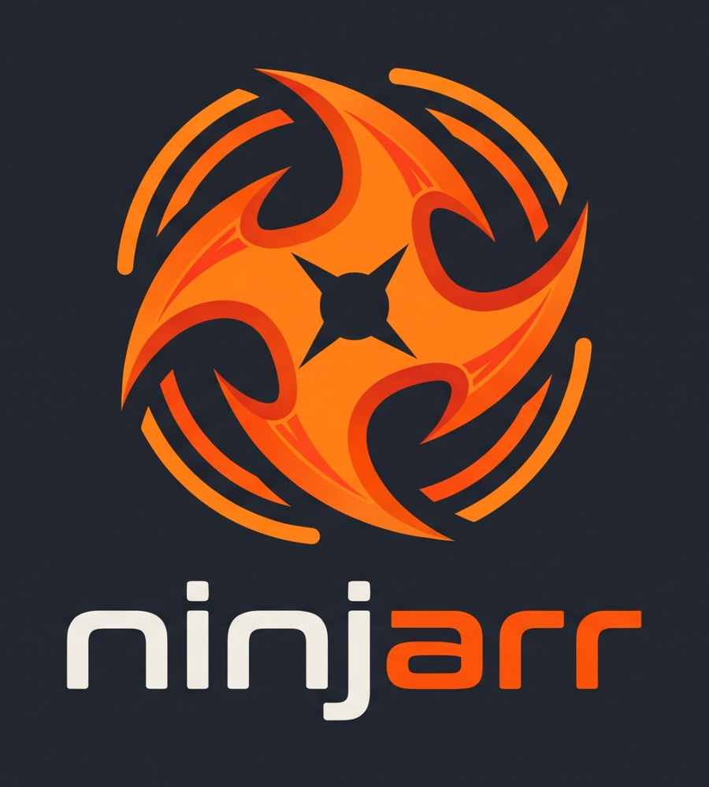
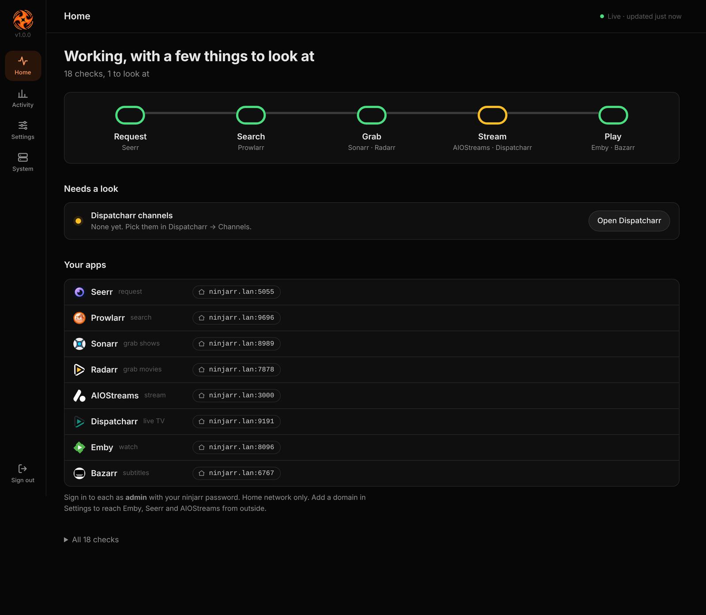
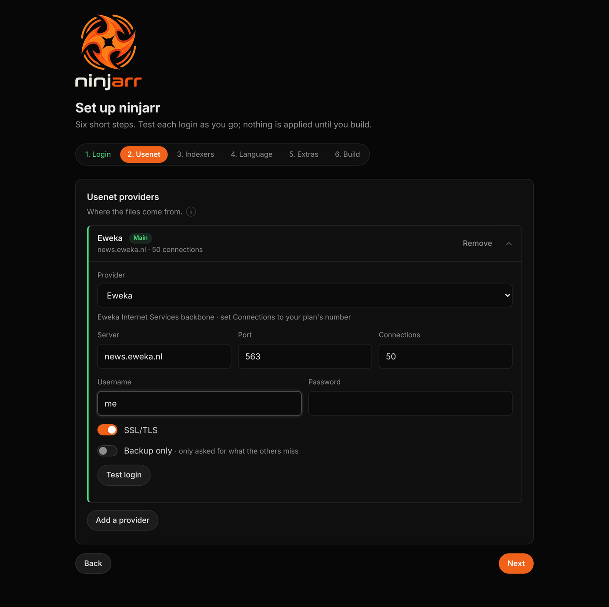
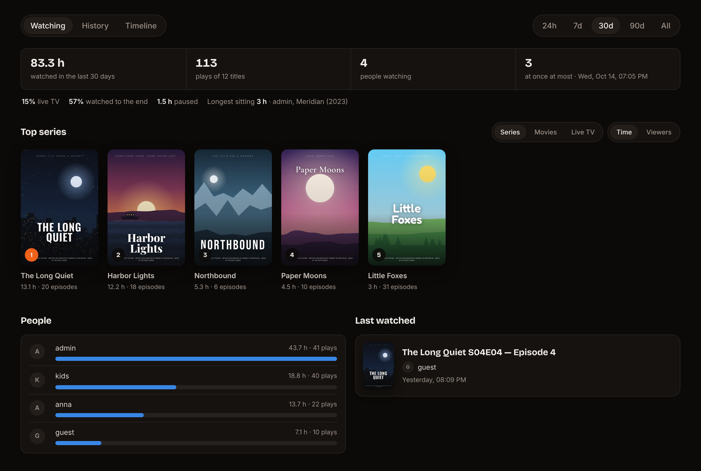
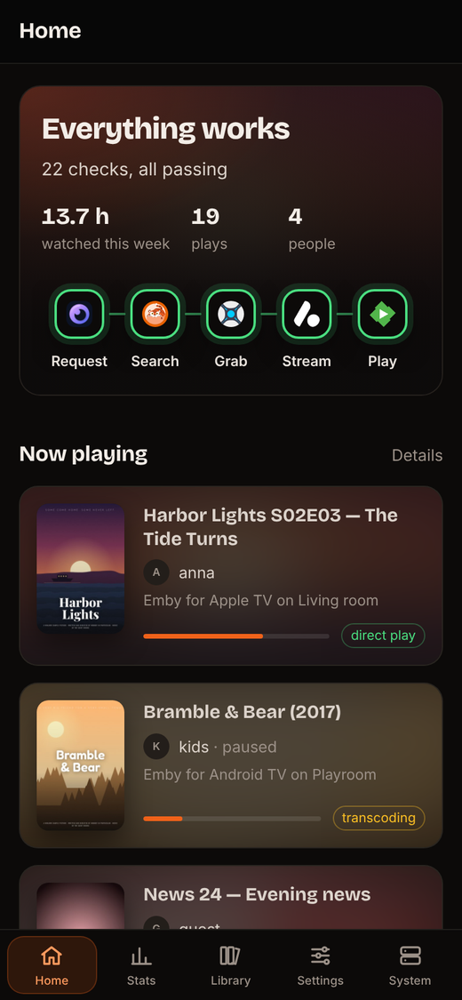

<div align="center">



**Your own streaming service, built by one command.**
Request a show, and a minute later it plays in Emby. Nothing is downloaded.

[](LICENSE)
[](bootstrap.sh)
[](compose/stack.yml)

</div>

---

ninjarr turns a fresh Debian VM into a complete home media server. You answer a few questions in your browser; it installs the apps, connects every one of them to the others, and checks that it all works.

Films and series come from **usenet** and are **streamed on demand** instead of downloaded, so a library of thousands of episodes fits on a 40 GB disk.

<p align="center"></p>

## What you get

- **Emby** to watch on your TV, phone or browser, with **Seerr** to request new titles.
- **Dojo**, a control panel: is everything working (with a fix button when not), who's watching what, watch stats, settings, backups and updates. Works on your phone, with push notifications.
- **Your language first.** Releases in your audio language win, then the best picture.
- **Self-healing.** Dead releases are found every night and replaced by themselves.
- **Optional:** live TV from your IPTV provider, HTTPS access from outside your home, hardware transcoding.
- **Safe updates.** App versions are tested every night before they reach you; every update backs up first.

<p align="center"></p>

## How it works

```
 You ask in Seerr ─▶ Sonarr / Radarr find a release through Prowlarr and your indexer
                                   │
                                   ▼
                 AIOStreams checks it on your usenet provider
                 and puts a link to it in the library
                                   │
                                   ▼
                 Emby plays it; AIOStreams streams the bytes as you watch
```

Every app is a well-known open-source tool; ninjarr is the glue that sets them up and keeps them connected.

> **Indexer rules:** some indexers forbid streaming tools. In ninjarr only Sonarr and Radarr talk to your indexer, exactly as in a normal download setup. Whether streaming is allowed is still between you and your indexer.

## What you need

- **A usenet provider** (Eweka, Newshosting, Easynews, …) and **an NZB indexer**.
- **A VM** with Debian 12/13 or Ubuntu 22.04+: 2 cores, 4 GB RAM, 40 GB disk. A VM, not an LXC container (AIOStreams needs FUSE).

## Install

**On Proxmox**, run this on the Proxmox host. It creates the VM for you:

```bash
curl -fsSLO https://raw.githubusercontent.com/DBCooperX/ninjarr/main/proxmox/create-vm.sh
chmod +x create-vm.sh && ./create-vm.sh
```

**On any other Debian or Ubuntu VM**, as root:

```bash
git clone https://github.com/DBCooperX/ninjarr.git /opt/ninjarr-src
cd /opt/ninjarr-src && ./bootstrap.sh
```

The terminal shows a link and a six-digit code. Open the link, enter the code and answer the questions: your login, usenet provider, indexer and language. Every login is tested before anything is built. Press **Build** and watch it set everything up.

<p align="center"></p>

| Open | Address | For |
|---|---|---|
| **Emby** | `http://<vm>:8096` | Watching |
| **Seerr** | `http://<vm>:5055` | Requesting films and series |
| **Dojo** | `http://<vm>:1337` | Everything else |

One username and password works everywhere. The rest (Sonarr, Radarr, Prowlarr, Bazarr, AIOStreams) is linked from Dojo; you rarely need to open it.

**Left for you:** Emby accounts for the rest of the household.

## Dojo

| Page | |
|---|---|
| **Home** | Does everything work, who's watching, what's new, and every app. |
| **Stats** | Watch history and charts: who watched what, when, on which device and how it played. |
| **Library** | How well the library plays: missing releases, language, 4K/HDR, upgrades — each with a button that fixes it. |
| **Settings** | Every setup answer, editable and tested. *Save and apply* re-wires the apps. |
| **System** | Updates, backups and the VM's own security updates. |

<p align="center">


</p>

**On your phone:** add Dojo to the home screen and it opens like an app. In Settings → Notifications, turn on push notifications for things like *something broke*, *your request is ready* or *someone started watching*. They arrive even away from home. Both need [Dojo over HTTPS](#access-from-outside).

**Dojo is home-network only.** It can change settings, so it's never exposed to the internet. Treat its login like the VM's root password.

## Access from outside

Give ninjarr a domain in Dojo → Settings → Away from home. Emby, Seerr and AIOStreams then get HTTPS addresses with free certificates: `emby.`, `request.` and `stream.<domain>`.

1. Add **DNS records** for those names, pointing at your home's public IP.
2. **Forward TCP 80 and 443** on your router to the VM.
3. Optionally, at home, rewrite the same names to the VM in AdGuard, Pi-hole or your router.

*Check DNS* in Settings tests it. Switch on *Dojo too* for `https://dojo.<domain>`; it still only answers devices on your home network, which is all a phone needs to install it and get notifications.

<details>
<summary>No certificate? (<code>ERR_SSL_PROTOCOL_ERROR</code>)</summary>

`sudo docker logs caddy 2>&1 | grep -i error` says why. Usually the ports still point at another machine or a DNS record is missing. Fix it, then `sudo docker restart caddy`.
</details>

## Live TV

Turn on live TV in the setup or in Dojo → Settings. ninjarr adds [Dispatcharr](https://github.com/Dispatcharr/Dispatcharr) with your IPTV provider and its guide, and makes it Emby's tuner. Then pick your channels in Dispatcharr → **Channels**. Emby needs **Emby Premiere** to show live TV.

## Hardware transcoding

When a device can't play a file directly, Emby converts it. On the CPU that can take a whole core per stream; on an Intel or AMD GPU only a few percent.

1. **On Proxmox:** enable VT-d (Intel) or AMD-Vi in the BIOS, add `intel_iommu=on iommu=pt` to the host's kernel options, and give the GPU to the VM (Hardware → Add → PCI Device).
2. **In Dojo:** press *Update*. ninjarr installs the drivers and asks for one restart. Afterwards Home shows *Emby transcodes on the Intel GPU*.

## Updates and backups

- **Updates:** Dojo → System shows when a new ninjarr is out and what's in it. *Update* backs up first, then moves every app to the versions tested for that release.
- **Tested app versions:** every night a bot builds the whole stack with the newest app images and runs every check, including a simulated AIOStreams outage that must not cost the library anything. What passes becomes a new ninjarr release by itself.
- **Can't wait?** System lists newer app versions. *Try it* upgrades one app and checks everything; if anything fails it rolls back by itself, and *Go back* undoes it later.
- **Backups** run nightly and keep the last 7: settings, every app's data and the watch history, usually a few MB. Download one now and then, or set `BACKUP_DIR` to a network share.
- **The VM** installs security updates nightly and offers *Restart now* when one needs it.

To restore, on a fresh VM or the same one (nothing is downloaded again):

```bash
git clone https://github.com/DBCooperX/ninjarr.git /opt/ninjarr-src && cd /opt/ninjarr-src
./bootstrap.sh restore /path/to/ninjarr-20261022-043012.tar.gz
```

<details>
<summary>Terminal commands</summary>

```bash
./bootstrap.sh              # build, or repair anything that drifted
./bootstrap.sh doctor       # check the whole chain (safe to paste into bug reports)
./bootstrap.sh update       # back up, then update
./bootstrap.sh wire         # re-apply all settings
./bootstrap.sh backup       # back up now
./bootstrap.sh restore F    # restore a backup (a path, or a name from the backup folder)
./bootstrap.sh try-version sonarr 4.0.20.3014-ls329   # try a newer app, roll back if it fails
./bootstrap.sh revert-version sonarr                  # undo the try
./bootstrap.sh import F     # bring over an existing stack (below)
./bootstrap.sh reconfigure  # answer the setup questions again
./bootstrap.sh status       # what's running
./bootstrap.sh down         # stop everything (data stays)
./bootstrap.sh --terminal   # set up in the terminal instead of the browser
```

`./create-vm.sh --env ninjarr.env` on Proxmox builds a whole VM unattended from a settings file; `ninjarr.env.example` lists every setting.
</details>

<details>
<summary>Moving from an existing AIOStreams + Sonarr/Radarr + Emby stack</summary>

Nothing is grabbed again, and Emby keeps its users, passwords and watch progress.

1. **Export**, as root where the old apps run (on Proxmox, the host). It asks where each app lives (`local`, `ct:110`, `ssh:root@host` or `skip`) and changes nothing:
   ```bash
   curl -fsSLO https://raw.githubusercontent.com/DBCooperX/ninjarr/main/migrate/export-legacy.sh
   bash export-legacy.sh
   ```
2. **Import** on the new ninjarr VM:
   ```bash
   cd /opt/ninjarr-src && sudo ./bootstrap.sh import ~/ninjarr-migrate-<date>.tar
   ```

The old Emby must be the same version as ninjarr's or older. When everything works, turn the old Emby off (both share a server ID) and delete the export file, which contains logins.
</details>

<details>
<summary>Quality rules</summary>

| | Score |
|---|---|
| Audio in your language | **+1000** |
| 4K | **+200** |
| AV1 (Apple TV, Nvidia Shield and older TVs can't play it directly) | **−300** |
| Dolby Vision without HDR, upscales, bad dubs, disc images, 3D | **never** |

So *German 4K* beats *German 1080p*, which beats *English 4K*. An English file is replaced as soon as one in your language appears. With a wait time set, other languages are only taken after the wait.
</details>

<details>
<summary>Good to know</summary>

- **It depends on usenet.** When a release disappears, a replacement is found overnight. A rare title with no complete copy left can't be replaced.
- **Settings ninjarr manages are locked** in AIOStreams' dashboard. Change them in Dojo.
- **Sonarr and Radarr always ask for the login** in the browser, even at home.
- **Coming from SABnzbd and a NAS?** There's nothing to carry over. Build fresh and re-add series in batches.
- **Security:** Dojo has no Docker access and can't change ninjarr's files. It asks the host to run a fixed list of jobs, and the host checks every setting it hands over. `ninjarr.env` is read as plain settings, never run.
</details>

<details>
<summary>What's in the repo</summary>

```
bootstrap.sh              entry point: questions → host → containers → wiring → report
lib/                      the steps (setup, host, wiring, backup, import, updates, doctor, …)
compose/stack.yml         the containers
versions.env              the app versions this release was tested with
dojo/                     Dojo (Flask, no build step) and the setup's provider and indexer lists
proxmox/                  create-vm.sh and the new VM's first boot
migrate/export-legacy.sh  exports an existing stack
ci/                       the nightly app-version bot
docs/                     README images and the terminal demo
```
</details>

## Credit

ninjarr is just the glue. Support the people who built the parts:
[AIOStreams](https://github.com/Viren070/AIOStreams) ·
[Sonarr](https://github.com/Sonarr/Sonarr) ·
[Radarr](https://github.com/Radarr/Radarr) ·
[Prowlarr](https://github.com/Prowlarr/Prowlarr) ·
[Bazarr](https://github.com/morpheus65535/bazarr) ·
[Seerr](https://github.com/seerr-team/seerr) ·
[Emby](https://emby.media) ·
[Dispatcharr](https://github.com/Dispatcharr/Dispatcharr) ·
[Caddy](https://caddyserver.com) ·
[LinuxServer.io](https://www.linuxserver.io/)

MIT licensed, see [LICENSE](LICENSE).
